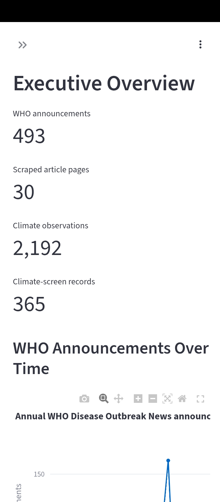
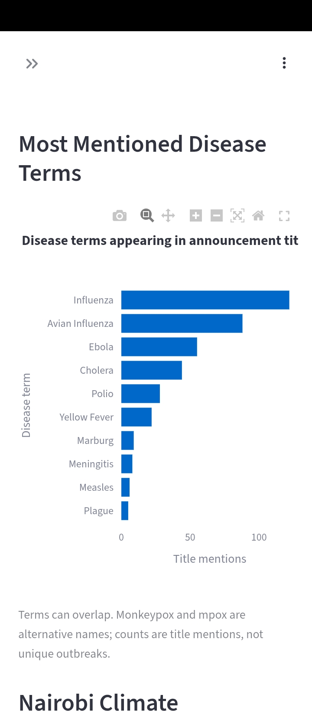
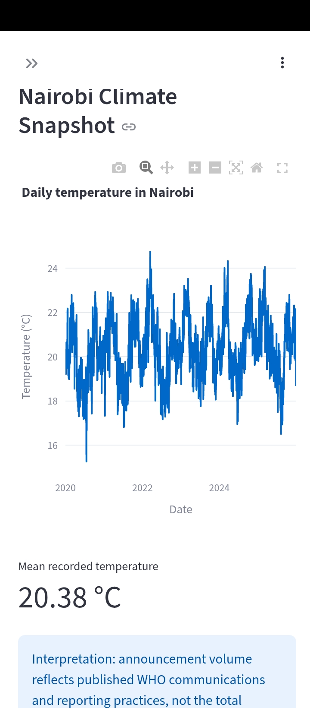
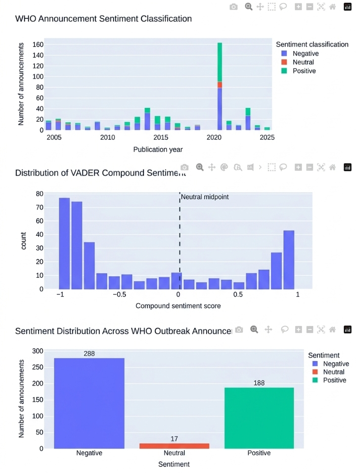

# CodeAlpha One Health Intelligence Platform

A public-health analytics project combining WHO Disease Outbreak News, NASA POWER climate observations, exploratory data analysis, interactive visualizations, and sentiment analysis.

## 🚀 Live Dashboard

**[👉 Open the CodeAlpha One Health Intelligence Dashboard](https://codealphaonehealthintelligence-jjm8evelq4rluyvyznwtpd.streamlit.app/)**

Explore the interactive public health dashboard featuring WHO disease outbreak announcements, Nairobi climate analysis, climate anomaly screening, interactive visualizations, and sentiment analysis.

**Technology:** Python | Streamlit | Pandas | Plotly | VADER
## Project Overview

This project collects and processes WHO Disease Outbreak News announcements, explores climate observations for Nairobi, Kenya, and presents findings through an interactive Streamlit dashboard.

## Key Features

- WHO Disease Outbreak News data collection and processing.
- Web scraping of a sample of WHO announcement pages.
- NASA POWER climate data analysis for Nairobi, Kenya.
- Exploratory data analysis and interactive Plotly visualizations.
- Statistical screening of potential climate anomalies.
- VADER sentiment analysis of WHO announcement text.
- Six interactive dashboard sections.
- Processed datasets and analysis reports.

## Dashboard Sections

1. Executive Overview
2. Disease Surveillance
3. Climate Explorer
4. Climate Anomaly Screen
5. WHO Article Explorer
6. Data Quality & Limitations

## 📊 Dashboard Screenshots

### Executive Overview



### Disease Surveillance



### Climate Explorer



### Sentiment Analysis



---

## 🔗 Project Links

- **Live Dashboard:** [Launch the Streamlit App](https://codealphaonehealthintelligence-jjm8evelq4rluyvyznwtpd.streamlit.app/)
- **Source Code:** [View the GitHub Repository](https://github.com/evanskips2727-del/CodeAlpha_OneHealthIntelligence)
## Sentiment Analysis Results

The analysis classified 493 WHO announcement records. Text extracted from 30 sampled article pages was merged into matching announcements, not counted as additional independent records.

| Classification | Records | Percentage |
|---|---:|---:|
| Negative | 288 | 58.42% |
| Neutral | 17 | 3.45% |
| Positive | 188 | 38.13% |

VADER compound scores range from -1 to +1. WHO outbreak reports commonly describe illness, transmission, and adverse events, which can influence sentiment classifications. These labels do not measure public opinion, clinical severity, or outbreak probability.

### Sentiment Visualizations

- `reports/sentiment_distribution.html`
- `reports/sentiment_compound_distribution.html`
- `reports/sentiment_by_year.html`

## Data Sources

- World Health Organization (WHO): Disease Outbreak News announcements and sampled article pages.
- NASA POWER: Daily climate observations for Nairobi, Kenya.

## Technology Stack

- Python
- Pandas and NumPy
- Requests
- Plotly
- Streamlit
- VADER SentimentIntensityAnalyzer
- Pytest

## Project Structure

```text
CodeAlpha_OneHealthIntelligence/
|-- app.py
|-- config/
|-- data/
|   |-- raw/
|   |-- processed/
|-- docs/
|-- notebooks/
|-- reports/
|-- src/
|-- tests/
```

## Running the Dashboard

Install the project's verified dependencies, then run:

```bash
streamlit run app.py
```

## Limitations

- This is an independent portfolio project, not an official WHO platform.
- Nairobi climate observations alone cannot establish causal relationships between climate and disease outbreaks.
- Climate anomaly flags are exploratory screens, not evidence of an outbreak.
- VADER is a general-purpose sentiment tool and has not been validated against a manually annotated public-health text dataset in this project.
- Data availability and reporting frequency can influence the results.

## Intended Use

This project is intended for portfolio demonstration, exploratory public-health analytics, and technical learning. It is not a clinical decision-support system or an operational outbreak-alert service.
